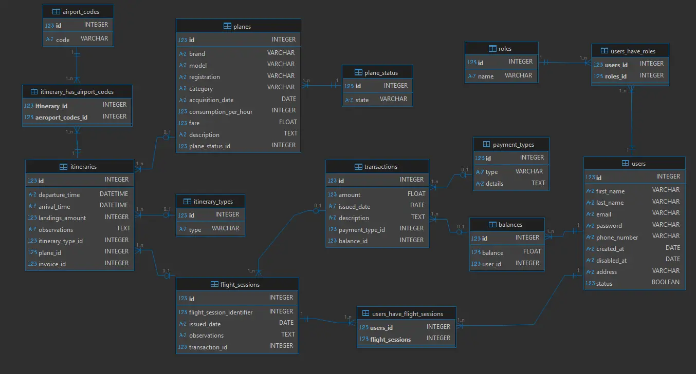

The ***Flask*** REST API for an **Aero Club training environment**, where users can manage their finances and flight sessions through structured
entities such as _balances_, _transactions_, _flight sessions_, and _itineraries_.
 
## Run and configure

You can run the app from the ``app.py`` file, where you can change the port and host. You'll need to install the libraries
using `pip install -r requirements.txt`. Make sure to use Python <= 3.13 and to configure the variables in the `.env` file (
setting up a secret key will be enough to run the system).

You can insert into the database all the necessary payment types, airport codes, roles, users, and more to run the Postman
examples
running the `database_filler.py` file in the root folder. This will populate the database with example data to play around.
Some data, like Roles and PaymentTypes is mandatory for many requests, so running the file is adviced.

There's an attached Postman collection for instructions to test the API.

### Roles and Permissions

There are **three user roles**, each defining what data and actions are allowed:

| Role           | Description                           | Permissions                                                                                                                                               |
|----------------|---------------------------------------|-----------------------------------------------------------------------------------------------------------------------------------------------------------|
| **User**       | Base role for all registered members. | Can view their own data (balance, transactions, flight sessions) and general club information (fares, planes, itinerary types, airport codes).            |
| **Instructor** | Users who conduct training flights.   | Can view all `User` data plus limited information about other users (students, other instructors, admins). Always has both `User` and `Instructor` roles. |
| **Admin**      | Full-access system manager.           | Can perform all CRUD operations, including managing users, planes, fares, and roles. Always has both `User` and `Admin` roles.                            |

Additional rules:

- Every account always includes the `User` role at minimum.
- **Disabled users** (`status=False`) cannot perform any requests.
- Account deactivation might take effect only after the current JWT expires (24 hours after issued).

### Financial system

Each user receives a **monetary balance** upon registration that can increase or decrease based on their activity in the Aero
club:

- Users can **add funds**: positive transactions via Cash, Transfer or Check.
- Users can **pay for flight sessions**: negative transactions that are registered by an admin as "Flight Session".
  There are **no upper or lower limits** on a user’s balance — administrative policies handle overdrafts or excessive credit
  manually.

### Flight Sessions

A **flight session** is the core training unit of the system — it represents one or more flight itineraries conducted between a *
*student (user)** and an **instructor** (optional).
Each flight session:

- Belongs to one **User**, it's registered by an Admin and can include an Instructor.
- Contains one or more **itineraries**, each describing a distinct segment, used plane, flight type, departing airport code and
  landing airport code of the overall training flight.
- Has an **issued date**, **observations**, and a **total session cost**.
- Is linked to a **transaction** that reflects the session’s cost and updates the user’s balance.

Flight times are recorded in 0.1h increments (6 minutes).
The cost of the session is calculated by adding together the: `plane fare * itinerary lenght` of each itinerary registered in the
session.

### Database diagram

