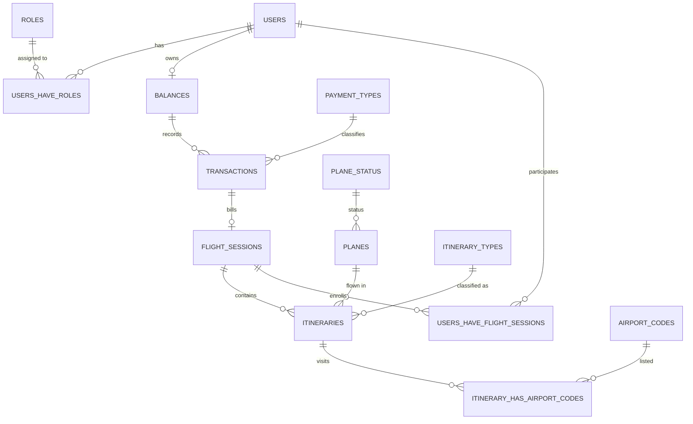

# Database

## Overview

The data model supports the club's two core concerns: **membership &
authorization** and **financial + flight ledger**. Seven association/join
tables tie users to roles, flight sessions, and airport codes.

## Entities

| Entity | Purpose | Notable columns |
| :--- | :--- | :--- |
| `users` | Registered members/clients | `email` (unique), `password` (hash), `status`, `disabled_at` |
| `roles` | RBAC roles | `name` unique (`User`, `Instructor`, `Admin`) |
| `balances` | Per-user account balance | `balance NUMERIC(10,2)`, `user_id` FK cascade |
| `transactions` | Ledger movements | signed `amount NUMERIC(10,2)`, `issued_date`, `payment_type_id`, `balance_id` |
| `planes` | Club aircraft | `registration` unique, `fare NUMERIC(10,2)`, `consumption_per_hour`, `plane_status_id` |
| `plane_status` | Aircraft state lookup | `state` unique (`Active`, `Under maintenance`, `Disabled`, `Out of service`) |
| `payment_types` | Transaction payment method | `type` unique (`Check`, `Cash`, `Transfer`, `Flight Session`) |
| `itinerary_types` | Flight segment type | `type` unique (`Solo`, `Dual`, `Cross-country`, `Instrument hood`, `Night`) |
| `airport_codes` | Airports | `code` unique (3 chars) |
| `itineraries` | A flight segment | `departure_time`/`arrival_time`, `landings_amount`, `plane_id`, `itinerary_type_id`, `invoice_id`→flight_session |
| `flight_sessions` | A training session (1+ itineraries) | `flight_session_identifier`, `issued_date`, `transaction_id` |

## Association tables (many-to-many)

| Table | Relations |
| :--- | :--- |
| `users_have_roles` | `users.id` ↔ `roles.id` |
| `users_have_flight_sessions` | `users.id` ↔ `flight_sessions.id` |
| `itinerary_has_airport_codes` | `itineraries.id` ↔ `airport_codes.id` |

## Entity-relationship diagram

> A mermaid reader/renderer (e.g. GitHub) renders the above as a diagram. The
> table below lists the same relationships textually.

## Textual relationships

- **User → Balance:** one-to-one. Created at registration.
- **User → Role:** many-to-many via `users_have_roles`.
- **User → Flight Session:** many-to-many via `users_have_flight_sessions`
  (a session involves a student and optionally an instructor; an admin is also
  attached on creation).
- **Balance → Transaction:** one-to-many. Transactions append to a balance.
- **Transaction → Flight Session:** a session links exactly one generated
  debit transaction (`flight_sessions.transaction_id`).
- **Flight Session → Itinerary:** one-to-many; a session groups one or more
  segments.
- **Itinerary → Plane / ItineraryType / AirportCodes:** segment references an
  aircraft, a type, and one or more airports.

## Behavior notes

- **Soft delete only:** users are deactivated (`status=False` +
  `disabled_at`); no hard delete exists.
- **Money:** monetary columns use `NUMERIC(10, 2)`.
- **Bootstrap:** tables are created at startup via `db.create_all()`. A
  canonical DDL snapshot lives in `db/migrations/V1__init.sql`.
- **Seed data:** `database_filler.py` inserts mandatory lookup rows (roles,
  payment types, airport codes, plane status, itinerary types) plus demo users
  and aircraft.